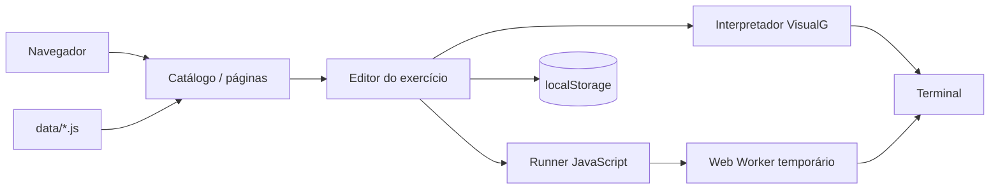

# Estudo de caso — Meteoro de Lógica

**Stack:** JavaScript · HTML/CSS · Web Worker · `node:test` · GitHub Actions  
**Demo:** https://gilvamoliveira.github.io/VisualG-JavaScript-Logic-Exercises-PROA/  
**Código:** https://github.com/GilvamOliveira/VisualG-JavaScript-Logic-Exercises-PROA

## Contexto

O Meteoro de Lógica nasceu no Instituto PROA como uma forma de estudar lógica a partir das apostilas Manzano e Faccat. O material original é extenso e mistura enunciados, exemplos em VisualG e exercícios em JavaScript. A proposta foi reunir tudo em uma aplicação única, navegável e executável no navegador.

## Problema

Estudar por PDFs separados exige alternar entre arquivos, procurar o exercício e copiar código para outra ferramenta. Além disso, VisualG e JavaScript têm sintaxes diferentes, mas o mesmo exercício precisa aparecer nas duas linguagens sem que o estudante perca o contexto.

## Objetivo

- Organizar 84 exercícios por apostila, página e assunto.
- Exibir as soluções em VisualG e JavaScript lado a lado.
- Permitir editar e executar as duas linguagens no navegador.
- Manter o projeto estático, sem back-end, e com testes automatizados.

## Escopo entregue

- Catálogo com 84 exercícios das apostilas Manzano e Faccat.
- Navegação por página, assunto e cartões de exercício.
- Editor com alternância entre VisualG e JavaScript.
- Terminal interativo para entrada e saída.
- Interpretador VisualG próprio, com suporte aos comandos usados no material.
- Execução de JavaScript em Web Worker, isolada da página.
- Persistência das edições no `localStorage`.
- Acesso às apostilas em PDF dentro da aplicação.
- Testes automatizados e CI no GitHub Actions.

## Arquitetura

O projeto é uma aplicação estática: não há servidor de aplicação nem banco. Os dados padrão vivem em arquivos JavaScript (`data/`), e as alterações do usuário ficam no armazenamento local do navegador. A execução de JavaScript acontece em um Web Worker temporário para não bloquear a interface.

## Decisões técnicas

1. **Interpretador VisualG próprio.** Em vez de transpilar VisualG para JavaScript, implementei um interpretador com análise de expressões, comandos de controle e mensagens de erro com linha. Isso preserva a semântica dos exemplos das apostilas.
2. **Web Worker para JavaScript.** O código do estudante roda fora da thread principal, com limite de 10 segundos e 100.000 caracteres de saída. A página continua responsiva mesmo com loops longos.
3. **Duas linguagens, dois estados independentes.** Editar ou executar VisualG não altera o código JavaScript, e vice-versa. A troca de aba é apenas visual.
4. **Persistência local por apostila.** As chaves `meteoro-exercises-manzano` e `meteoro-exercises-faccat` guardam as alterações. Os dados padrão continuam nos arquivos `data/`, o que permite restaurar o catálogo limpando o armazenamento.
5. **Sem build e sem dependências de runtime.** O projeto abre em qualquer servidor HTTP estático. Isso reduz atrito para estudar, publicar e revisar.
6. **Testes como contrato do catálogo.** Os testes verificam se os 84 exercícios têm IDs únicos, soluções nas duas linguagens e detalhes consistentes. Também compilam todo o VisualG e validam a sintaxe de todo o JavaScript.

## Testes e qualidade

- **23 testes** com `node:test`, todos passando.
- Cobertura do interpretador: precedência, vírgula decimal, `se/senao`, `enquanto`, `para`, `repita`, formatação e erros.
- Validação do catálogo: 84 exercícios, IDs únicos e presença de soluções nas duas linguagens.
- Verificação de que as páginas carregam os elementos e scripts esperados.
- CI em cada push e pull request.

## Desafios

- **Fidelidade ao VisualG.** O interpretador precisou lidar com números com vírgula, nomes de variáveis sem diferenciação de maiúsculas/minúsculas, laços e `interrompa`.
- **Entrada assíncrona no navegador.** `Leia()` e `readLine()` não podem bloquear a thread. A solução foi modelar a entrada como uma promessa resolvida pelo terminal.
- **Erros compreensíveis.** O interpretador informa a linha e a causa da falha, em vez de apenas lançar uma exceção genérica.
- **Persistência sem perder o padrão.** Alterações locais são mescladas com os dados padrão, mas o código original continua disponível nos arquivos `data/`.

## Limites e próximos passos

- Compartilhar um exercício por URL com o código atual.
- Exportar e importar as alterações locais em JSON.
- Ampliar a cobertura do interpretador para mais construções do VisualG.
- Melhorar a navegação por teclado e os rótulos de acessibilidade do editor.
- Adicionar mais apostilas e exercícios sem duplicar a lógica de catálogo.
